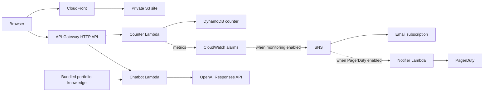

# Architecture

[Back to the README](../README.md)

The resource definitions in [Infra/](../Infra/) are the source of truth. The existing [portfolio architecture illustration](../Frontend/architecture.svg) is retained as a presentation asset.

## Website and environments

[main.tf](../Infra/main.tf) configures a private S3 origin, CloudFront origin access control, HTTPS redirection, and custom error pages. Terraform renders [index.html.tpl](../Frontend/index.html.tpl) with the API URL and uploads it as `index.html`; other frontend files are uploaded from the configured website directory. The template is not a standalone generated page.

Only `environment = "prod"` enables the custom root/www domains and DNS-validated ACM certificate in `us-east-1`. Other environments use their CloudFront domain and default certificate. Resource names include the environment; PR deployments use `pr-<number>`. Remote-state buckets, lock tables, GitHub OIDC roles, and the production public Route 53 zone must already exist.

## API behavior

Both routes are public and use wildcard CORS. The HTTP API default stage auto-deploys. Its configured default throttle is 10 requests/second with a burst of 20; the chatbot route defaults to 2 requests/second with a burst of 5.

| Route | Input | Success | Behavior |
| --- | --- | --- | --- |
| `GET /counter` | No body | `{"count": 7}` | Atomically increments the `visitor_count` item on every request, including reloads and tests |
| `POST /chat` | `{"question": "What is Michael's Terraform experience?"}` | `{"answer": "..."}` | Accepts a nonempty question of up to 500 characters and returns an answer |

The counter handler in [lambda_function.py](../Backend/lambda_function.py) returns HTTP 500 on a caught DynamoDB client error. A browser failure displays `Live` instead of a number. This is a request counter; there is no visitor identity or deduplication.

The chatbot in [chatbot_function.py](../Backend/chatbot_function.py) reads [chatbot_knowledge.md](../Backend/chatbot_knowledge.md), uses the `OPENAI_API_KEY` environment variable, and defaults `OPENAI_MODEL` to `gpt-5-mini`. The knowledge is bundled into the Lambda artifact. Only upstream error codes `insufficient_quota` and `rate_limit_exceeded` select the built-in keyword fallback and add `"source": "local_fallback"` to the response. A missing API key returns HTTP 500; it does not enable a general offline mode. Fallback answer text is maintained in Python separately from the knowledge file.

## Packaging and observability

[code_signing.tf](../Infra/code_signing.tf) defines a versioned signing-artifact bucket, an AWS Signer profile, and a Lambda signing policy that defaults to `Enforce`. The workflow builds three ZIPs and passes their signed S3 keys and object versions to Terraform. Local unsigned ZIP definitions also exist, but do not by themselves satisfy that enforcement policy.

Each Lambda has a CloudWatch log group, retained for 30 days in production and 7 days elsewhere by default. Counter X-Ray tracing and DynamoDB point-in-time recovery are available but disabled by default. Monitoring defaults to production only unless overridden. The error, duration, and invocation alarms monitor the counter Lambda; equivalent chatbot alarms are not defined. PagerDuty resources require both monitoring and `enable_pagerduty = true`.

The [operations guide](operations.md) describes deployment prerequisites and current limits, including signing bootstrap and cleanup behavior.
