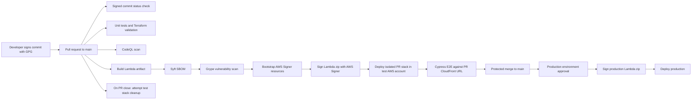

# Security and Supply Chain Flow

[Back to the README](../README.md)

The repository defines a staged delivery path with PR test environments and production deployment. The diagram shows the intended protected-merge process; it depends on GitHub settings and working AWS configuration. See [deployment and operations](operations.md) for exact triggers, bootstrap limits, and cleanup behavior.



## Detection and Mitigation Points

- **Developer workstation:** commit signing associates a commit with a signing key. The workflow checks GitHub's `verification.verified` result; trust in the signer still depends on key/account management.
- **GitHub branch protection:** require signed commits, the `Verify Signed Commits` status check, CodeQL, SBOM/Grype, tests, and Cypress before merging.
- **CodeQL:** scans Python and JavaScript on pull requests, pushes to `main`, and monthly on a schedule.
- **Syft SBOM:** inventories copied backend source files before ZIP creation. The build currently bundles no Python dependencies, so this is not an inventory of the AWS-managed Python runtime or its libraries.
- **Grype:** scans the generated SBOM and fails that job for High or Critical dependency vulnerabilities it detects.
- **AWS Signer and Lambda code signing:** Terraform defaults the policy to `Enforce`; deploying unsigned packages is incompatible with that policy. Review the bootstrap dependencies described in the operations guide.
- **Per-PR AWS test stack:** each pull request deploys its own resources using the PR number in the Terraform state key and resource environment name.
- **Production environment approval:** GitHub Environment protection can require manual approval before production deployment. The workflow's environment declaration alone does not enable reviewers or branch restrictions.

## Remaining Risks

- An earlier version of this guide records that a PagerDuty key was present in `Infra/terraform.tfvars`. Retain this as an incident follow-up: verify the key was revoked/rotated and review history exposure. Removing a current file or adding an ignore rule does not revoke a key or erase historical copies.
- GitHub branch protection and environment reviewers are configured in GitHub settings, not in this repository.
- GitHub CodeQL can upload findings automatically, but blocking merges on High or Critical code scanning alerts must be enabled with repository rulesets or branch protection.
- The workflow relies on OIDC IAM roles. Those roles should use least privilege and trust only this repository and expected branches/events.
- Signed-commit verification and CodeQL are independent workflows, not direct dependencies of the deployment jobs. Use branch/environment controls to enforce the intended release gates.
- Both application routes are public and allow wildcard CORS. Route throttles are configured, but authentication, per-user quotas, and chatbot-specific alarms are not defined.
- Terraform-sensitive values can still appear in state and are used as Lambda environment variables. Protect state and deployment-role access.
- The test and production AWS accounts should have separate state buckets, lock tables, budgets, and IAM roles.
- For a sensitive or multi-collaborator project, add SLSA provenance attestations, pin third-party GitHub Actions to commit SHAs, use Dependabot, require two-person production approval, and add automated secret scanning.

## GitHub Settings Checklist

- Enable **Require signed commits** on the protected `main` branch.
- Require these status checks before merge:
  - `Verify Signed Commits`
  - `Validate Code and IaC`
  - `SBOM and Dependency Vulnerability Scan`
  - `CodeQL Analyze`
  - `Cypress Test Environment E2E`
- Enable code scanning merge protection for alerts at severity **High** or higher.
- Create a `production` GitHub Environment and add required reviewers for manual approval.
- Add repository variables: `AWS_REGION`, `BUCKET_NAME`, `DOMAIN_NAME`, `ROUTE53_ZONE_ID`, `ALERT_EMAIL`, `PAGERDUTY_URL`, `TEST_TF_STATE_BUCKET`, `TEST_TF_LOCK_TABLE`.
- Review the production state configuration in [backend-prod.hcl](../Infra/backend-prod.hcl). `PROD_TF_STATE_BUCKET` and `PROD_TF_LOCK_TABLE` were listed in the original checklist but are not consumed by the current workflow.
- Add repository secrets: `TEST_AWS_ROLE_ARN`, `PROD_AWS_ROLE_ARN`, `PAGERDUTY_INTEGRATION_KEY`, `OPENAI_API_KEY`.

## Local GPG Commit Signing

```bash
gpg --full-generate-key
gpg --list-secret-keys --keyid-format=long
gpg --armor --export YOUR_KEY_ID
git config --local user.signingkey YOUR_KEY_ID
git config --local commit.gpgsign true
git config --local tag.gpgsign true
```

Run the Git configuration commands inside this repository after replacing `YOUR_KEY_ID` with your own key ID. Add only the exported public key to GitHub under **Settings > SSH and GPG keys**; keep the private key private. Check GitHub's verification result before opening a PR. The repository-local settings above do not change signing behavior in other repositories.
